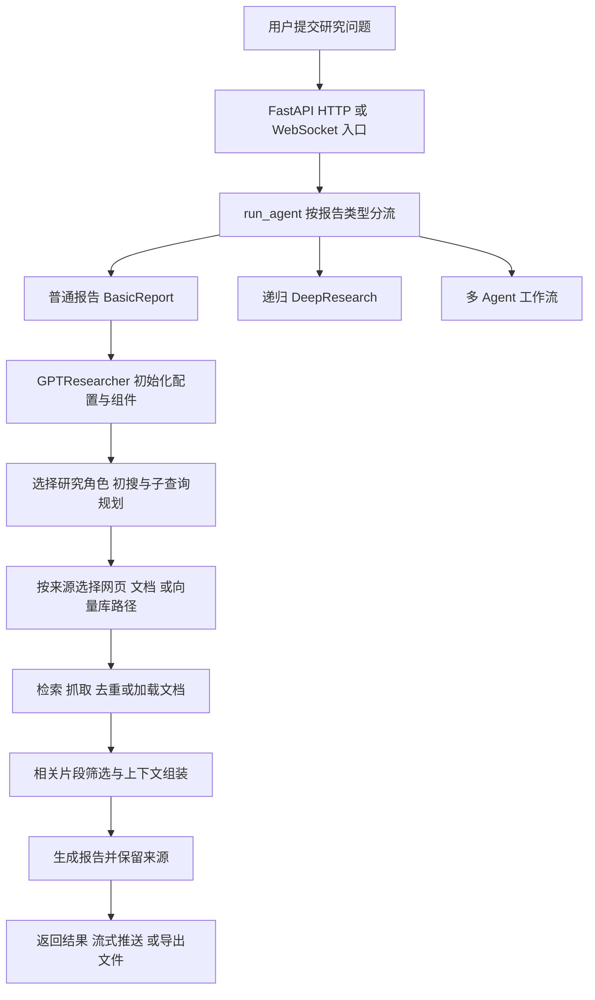

# GPT Researcher 项目面试题库（320 题）

整理日期：2026-10-28。依据本工作区源码、`PROJECT_STUDY_INDEX.md` 和 Milvus 练习说明整理，侧重 Python 后端、LLM 应用、RAG、Agent 工程岗位。

本题库提供：320 道问题与答题要点、24 道高频题展开示例、源码入口、代码审查题、模拟面试顺序。题目中的“如何设计、如何改造”属于扩展方案，不代表仓库已经实现。

## 使用方法与项目表述边界

- **优先级**：★ 必须能独立讲清；△ 二轮常见追问；◇ 进阶或生产化设计。优先级只表示备考顺序。
- **答题顺序**：业务问题 → 本项目调用链 → 关键取舍 → 失败边界 → 验证方法。不要只解释名词。
- **工作归属**：这是 GPT Researcher 开源项目的学习与实践工作区。区分“上游已有功能”“自己阅读或复现的部分”“自己实际修改的部分”。未核实的个人贡献不写成已完成。
- **验证边界**：学习记录中的历史验证不等于本轮重新执行。本轮阅读源码并整理题库，没有运行真实模型、付费接口、完整测试或压力测试。
- **Milvus 边界**：`milvus-demo/README.md` 记录的验证使用真实数据库和 PDF/分块链路，但 Embedding 使用六维词频测试向量，规划使用测试替身；它不能证明真实语义召回效果。
- **练习文件边界**：学习索引引用的主要练习文件位于另一个目录。本题库没有重新读取该外部练习文件；关于练习实现的说明依据本工作区保存的学习记录与 Milvus README。
- **指标边界**：README 中的耗时、费用、benchmark 分数属于项目材料中的结果，不能当作你亲自测出的成果。简历中的提升比例应有自己的基线、样本、配置和原始结果。

## 一条必须讲顺的主链

这是概念主链，不表示所有报告模式都严格执行同一套步骤。尤其要区分：普通研究角色选择、递归深度研究、LangGraph 多 Agent、Deep Agents SDK 示例。

## 源码复习入口

| 范围 | 优先阅读位置 | 要解决的问题 |
|---|---|---|
| HTTP 入口 | [app.py](D:/桌面/课程/project2/backend/server/app.py) | 请求、同步等待、后台生成、报告 API |
| WebSocket 与模式分流 | [websocket_manager.py](D:/桌面/课程/project2/backend/server/websocket_manager.py)、[server_utils.py](D:/桌面/课程/project2/backend/server/server_utils.py) | 连接、任务、消息、人工反馈 |
| 普通报告 | [basic_report.py](D:/桌面/课程/project2/backend/report_type/basic_report/basic_report.py) | conduct_research 与 write_report 如何串联 |
| 核心对象 | [agent.py](D:/桌面/课程/project2/gpt_researcher/agent.py) | 状态、组件装配、研究和写作入口 |
| 配置 | [config.py](D:/桌面/课程/project2/gpt_researcher/config/config.py) | 默认值、文件、环境变量、类型转换 |
| 规划 | [query_processing.py](D:/桌面/课程/project2/gpt_researcher/actions/query_processing.py)、[agent_creator.py](D:/桌面/课程/project2/gpt_researcher/actions/agent_creator.py) | 初搜、角色、JSON 规范化、重试与降级 |
| 研究调度 | [researcher.py](D:/桌面/课程/project2/gpt_researcher/skills/researcher.py) | 来源分支、并发子查询、MCP 缓存、去重 |
| 抓取 | [browser.py](D:/桌面/课程/project2/gpt_researcher/skills/browser.py)、[workers.py](D:/桌面/课程/project2/gpt_researcher/utils/workers.py) | 阻塞任务、线程池、并发限制 |
| 频率控制 | [rate_limiter.py](D:/桌面/课程/project2/gpt_researcher/utils/rate_limiter.py) | 进程内共享限流及其边界 |
| 上下文 | [compression.py](D:/桌面/课程/project2/gpt_researcher/context/compression.py)、[context_manager.py](D:/桌面/课程/project2/gpt_researcher/skills/context_manager.py) | 分块、Embedding 过滤、短材料快路径 |
| 向量库 | [vector_store.py](D:/桌面/课程/project2/gpt_researcher/vector_store/vector_store.py)、[Milvus README](D:/桌面/课程/project2/milvus-demo/README.md) | 文档转换、入库、过滤、真实验证范围 |
| 报告生成 | [writer.py](D:/桌面/课程/project2/gpt_researcher/skills/writer.py)、[report_generation.py](D:/桌面/课程/project2/gpt_researcher/actions/report_generation.py) | 参数、空上下文、正文和引用 |
| 递归研究 | [deep_research.py](D:/桌面/课程/project2/gpt_researcher/skills/deep_research.py) | breadth、depth、汇总、递归停止 |
| LangGraph | [orchestrator.py](D:/桌面/课程/project2/multi_agents/agents/orchestrator.py)、[editor.py](D:/桌面/课程/project2/multi_agents/agents/editor.py) | 顶层图、章节子图、审阅循环 |
| Deep Agents | [agent.py](D:/桌面/课程/project2/deep_agents/agent.py)、[tools.py](D:/桌面/课程/project2/deep_agents/tools.py) | 工具边界、文件上下文、SDK 编排 |
| 模型调用 | [llm.py](D:/桌面/课程/project2/gpt_researcher/utils/llm.py)、[base.py](D:/桌面/课程/project2/gpt_researcher/llm_provider/generic/base.py) | Provider、流式、元数据、重试 |
| 持久化 | [report_store.py](D:/桌面/课程/project2/backend/server/report_store.py) | JSON 存储、锁、临时文件替换 |
| 前端 | [useWebSocket.ts](D:/桌面/课程/project2/frontend/nextjs/hooks/useWebSocket.ts) | 消息解析、报告更新、人工反馈 |
| 测试和评测 | [tests](D:/桌面/课程/project2/tests)、[evals](D:/桌面/课程/project2/evals)、[benchmark 说明](D:/桌面/课程/project2/deep_agents/BENCHMARK.md) | 正确性、质量、费用和公平比较 |

## 01｜项目介绍、个人贡献与业务价值（001—015）

**001 ★ 请用一分钟介绍这个项目。**  
要点：面向研究问题自动规划、检索、阅读资料并生成带来源报告；说明技术栈和自己实际承担的范围。

**002 ★ 这个项目解决了什么具体问题？**  
要点：降低人工搜集、筛选、整理资料的重复成本；保留证据路径，处理模型知识时效和材料长度限制。

**003 ★ 与直接向大模型提问有什么区别？**  
要点：引入外部证据、多查询、正文抓取、相关片段筛选和来源追踪；这些机制降低风险，但不保证结论正确。

**004 ★ 与普通搜索引擎或搜索摘要产品相比，增加了什么？**  
要点：从“返回链接/摘要”扩展到规划、跨来源阅读、综合写作、章节研究与报告交付。

**005 ★ 你的个人贡献具体是什么？**  
要点：列出亲自完成的代码、验证和问题定位；能展示文件或记录，区分学习、复现、修改和原创设计。

**006 ★ 项目是独立开发还是基于开源二次实践？**  
要点：明确开源基础、实际使用版本和复现范围；不要把上游的完整能力归为个人实现。

**007 ★ 你最熟悉的一条完整调用链是什么？**  
要点：从请求入口讲到研究、上下文、写作和响应，并说明每一步的输入、输出、状态归属。

**008 ★ 项目中最有技术含量的三个点是什么？**  
要点：选择自己能深入解释的点，例如并发检索、RAG 上下文处理、递归研究停止和 Agent 状态管理。

**009 ★ 你遇到的最难问题是什么，如何定位和验证？**  
要点：给出具体症状、最小复现、调用链定位、修复或方案、回归证据；不编造故障经历。

**010 △ 谁会使用这个系统，适合什么任务？**  
要点：调研、资料综合、知识检索；区分事实短问答与需要多来源、多章节研究的任务。

**011 △ 哪些任务不值得启动完整研究流程？**  
要点：简单事实核查或少量资料定位可走 quick_search；先按任务复杂度和预算路由。

**012 ★ 如何证明系统比原有方案更好？**  
要点：同题集、同模型和预算比较答案质量、证据支持、耗时与费用，保留人工审查样本。

**013 △ 为什么选择这些技术，而不是全部自己写？**  
要点：结合异步后端、模型适配、文档生态和图编排需求；同时说明框架抽象和依赖复杂度的代价。

**014 ★ 如果只允许保留一个亮点，你会选什么？**  
要点：选有实现和验证支撑的点，说明它解决的业务障碍；“用了很多框架”不是充分答案。

**015 △ 项目目前最大的不足和下一步是什么？**  
要点：从真实模型评测、引用核验、任务持久化、权限隔离或失败恢复中按证据选优先项。

## 02｜整体架构、职责拆分与数据流（016—030）

**016 ★ 用户提交一个问题后，系统完整执行过程是什么？**  
要点：入口校验 → 报告分流 → 初始化 → 研究规划 → 获取与筛选资料 → 写作 → 导出/返回。

**017 ★ FastAPI、BasicReport、GPTResearcher 分别负责什么？**  
要点：入口和协议、报告级编排、研究能力与任务状态；避免把全部逻辑堆到路由函数。

**018 ★ ResearchConductor、ContextManager、ReportGenerator 为什么分开？**  
要点：分别处理资料获取、相关上下文、写作；各组件通过父研究对象访问共享任务状态。

**019 ★ conduct_research 和 write_report 为什么拆成两步？**  
要点：区分证据准备与生成，方便材料复用、独立调试、定制写作及分阶段失败处理。

**020 ★ query、sub_queries、research_sources、context、report 有什么区别？**  
要点：研究目标、执行计划、原始材料、供模型使用的筛选材料、最终文本；不能互相混称。

**021 ★ visited_urls 与 research_sources 有什么区别？**  
要点：前者用于 URL 访问去重，后者保存材料；访问登记不等于抓取成功或正文引用。

**022 △ 为什么组件保存 self.researcher，而不是复制整个对象？**  
要点：共享当前任务配置与状态；代价是隐式耦合、生命周期和并发写入边界需要明确。

**023 △ HTTP、WebSocket、CLI 能否复用研究逻辑？**  
要点：让核心服务不依赖特定传输；协议层转换参数和事件，核心返回统一结果。

**024 ★ 普通报告、详细报告、递归深度研究如何区分？**  
要点：普通主链、围绕章节组织的报告、沿后续问题多层探索；名称相近不代表同一种执行流程。

**025 ★ “选择一个研究角色”是否就是多 Agent 系统？**  
要点：角色提示词决定单个研究对象的视角；多 Agent 涉及多个职责、任务、状态与协作流程。

**026 △ 哪些模块是可替换扩展点？**  
要点：Retriever、Scraper、LLM Provider、Embedding、向量库、提示词族和输出适配。

**027 △ 如何用接口减少不同检索服务的耦合？**  
要点：统一输入参数、返回结构、错误约定与能力声明；供应商差异保留在适配层。

**028 ◇ 若要抽成可复用研究服务，你会怎样重构？**  
要点：任务配置、执行器、事件输出、证据存储、模型网关分离，明确副作用和依赖注入。

**029 ★ 哪些信息属于任务状态，哪些属于应用配置？**  
要点：query/context/costs 是任务级；默认 Provider 和连接池可应用级，密钥及租户配置需隔离。

**030 ◇ 如何表示整个研究任务的生命周期？**  
要点：排队、规划、检索、写作、导出、完成、失败、取消；保存阶段产物和失败原因。

## 03｜配置、初始化、Python 对象状态（031—045）

**031 ★ 配置文件路径、默认配置、环境变量如何决定最终配置？**  
要点：显式 config_path 优先于 CONFIG_PATH；文件覆盖默认字段，字段环境变量再覆盖合并值。

**032 ★ 环境变量都是字符串，如何转换布尔值、列表、字典和可空值？**  
要点：依据字段类型解析并校验，拒绝错误格式；不要用 bool("false") 解析布尔值。

**033 △ provider:model 为什么要拆成两个字段？**  
要点：分别决定客户端适配和模型名；解析要保留模型名内部可能存在的后续冒号。

**034 △ 找不到配置文件应该报错还是使用默认值？**  
要点：源码有默认回退；讨论本地体验与生产静默误配置的取舍，关键配置可选择严格启动校验。

**035 ★ GPTResearcher 初始化需要装配哪些核心组件？**  
要点：Config、Retriever 类列表、Memory/Embedding、研究/上下文/抓取/写作组件和深度研究能力。

**036 ★ 为什么传入的 visited_urls 可能有意被多个对象共享？**  
要点：跨子研究去重；说明共享引用与复制的差异，同时解释失败后重试及范围污染风险。

**037 ★ 为什么不能用 visited_urls or set() 保证保留外部集合？**  
要点：空集合为假，会被替换；要用 is None 判断才能保留调用方传入的空容器身份。

**038 ★ 函数参数写成 query_domains=[] 有什么风险？**  
要点：默认对象跨调用共享；是否构成实际污染取决于后续是否修改，优先使用 None 后创建。

**039 ★ 浅复制和深复制在这个项目里有什么区别？**  
要点：dict.copy 不复制嵌套可变对象；报告参数浅复制适合只替换顶层字段，共享内容需额外判断。

**040 △ Python 中两个组件都使用 self，它们是同一个对象吗？**  
要点：self 分别指各自实例；组件的 self.researcher 才是它们引用的父研究对象。

**041 △ 为什么运行时修改 os.environ 不适合承载每个用户的配置？**  
要点：环境变量是进程共享状态，异步请求会相互覆盖；应使用任务级配置和客户端实例。

**042 △ 构造函数中立刻创建线程池、模型客户端有什么代价？**  
要点：资源和初始化成本、未使用组件也可能失败；考虑惰性创建、连接复用和关闭时机。

**043 △ kwargs 持续向下透传会带来什么问题？**  
要点：字段冲突、未知参数、配置归属难追；关键边界使用显式参数或结构化配置。

**044 ◇ 如何实现安全的配置热更新？**  
要点：任务开始时读取版本化快照，校验后原子替换应用默认值，执行中的任务保持配置一致。

**045 ◇ 如何测试两个用户的研究状态完全隔离？**  
要点：交错执行不同 query/source/config，断言容器身份、来源、成本、报告互不串用。

## 04｜角色、规划、提示词与结构化输出（046—060）

**046 ★ 为什么研究之前要生成子查询？**  
要点：覆盖不同维度并减小单次查询歧义；同时控制重复、偏题和调用成本。

**047 ★ 为什么先初搜再规划，而不是直接规划？**  
要点：用初搜补充术语和现实背景，减少凭模型先验拆题；初搜失败或为空的行为应单独定义。

**048 ★ 角色选择和子查询规划分别输出什么？**  
要点：前者是角色/提示词信息，后者是查询字符串列表；它们都不是最终研究上下文。

**049 ★ 提示词里的“最多生成 N 个查询”是硬限制吗？**  
要点：不是；解析后还要做类型、数量、长度、去重与语义检查，不能依赖自然语言约束。

**050 ★ 模型返回合法 JSON 是否就能直接使用？**  
要点：还需检查字段、类型、非空、取值范围；格式正确不等于结构正确，更不等于事实正确。

**051 ★ JSON 修复、结构校验、业务校验有什么区别？**  
要点：分别处理格式、数据形状和任务约束；修复库不能替代后两者。

**052 ★ 当前 _normalize_sub_queries 接受哪些输入？有哪些边界？**  
要点：列表、常见列表字段字典、单 query 字典、字符串；当前还会字符串化非字符串项，且不去重或截断。

**053 △ 空的 queries 字段与非空 sub_queries 同时出现会怎样？**  
要点：当前实现遇到第一个列表字段就停止，空列表也会命中；随后可能回退原问题。

**054 ★ 规划模型调用失败时的恢复顺序是什么？**  
要点：战略模型首次调用 → 携带指定 token 上限重试 → smart 模型降级；还有底层模型封装重试。

**055 ★ JSON 解析失败会触发上述模型调用重试吗？**  
要点：当前解析位于调用 try/except 之后；格式处理路径与调用异常路径不同，需要按实际代码回答。

**056 △ 为什么把原问题追加到子查询里？会有什么副作用？**  
要点：防止拆题遗漏总体目标；当前部分路径直接 append，可能与规划结果重复。

**057 △ 如何判断子查询质量？**  
要点：覆盖度、独立性、可检索性、证据增量、最终答案收益；不能只数查询条数。

**058 ◇ 用户的问题含糊时，应追问还是自动假设？**  
要点：依据歧义影响和成本，记录假设；高影响范围先澄清，其余可带明确假设继续。

**059 ◇ 如何防止提示词注入污染研究计划？**  
要点：将外部材料视为数据，隔离指令层级，限制工具能力，校验计划；提示词声明本身不构成完整防护。

**060 ◇ 如何避免重复规划导致研究范围不断扩大？**  
要点：保存目标与已覆盖维度，比较新查询的信息增量，限制规划次数、节点数和总预算。

## 05｜Retriever、搜索适配与数据质量（061—075）

**061 ★ Retriever 和 Scraper 有什么区别？**  
要点：前者寻找候选结果，后者获取页面或文件正文；某些服务也直接提供正文，不能重复抓取。

**062 ★ 为什么工厂返回检索器类，而不是已初始化实例？**  
要点：实例往往绑定 query、headers、域名范围和 researcher；每次搜索再按任务参数实例化。

**063 ★ 初搜与正式子查询搜索使用检索器的方式有什么区别？**  
要点：初搜包装使用第一个选定检索器；正式研究路径可组合多个检索器，不能混为一谈。

**064 ★ 不同搜索 API 的结果如何统一？**  
要点：把 title、URL、snippet/body/raw_content 映射为稳定结构，区分摘要和正文，并保留来源信息。

**065 △ 一个检索器返回 None、字典或畸形列表，系统如何处理？**  
要点：适配层防御校验，隔离坏项、记录结构异常；不要让迭代字典键被误当搜索结果。

**066 ★ 一个搜索服务失败，是否应导致整个任务失败？**  
要点：多来源通常局部降级；同时标记覆盖不足，全部失败时不能伪装成正常完成。

**067 △ 多个搜索引擎的结果如何去重与排序？**  
要点：URL 规范化、内容指纹、来源分数或排名融合；注意保留可用于交叉核查的独立证据。

**068 △ 搜索 top-k 越大越好吗？**  
要点：召回增加也带来噪声、抓取和上下文费用；根据边际证据收益与预算选择。

**069 ★ max_iterations、max_search_results 与最终上下文条数有什么区别？**  
要点：规划数量、每次搜索候选数、筛选后材料数量是不同阶段的控制项。

**070 △ 域名过滤应该在哪一层执行？**  
要点：服务端查询约束加返回结果校验；仅拼接查询词不能构成可靠的访问控制。

**071 △ 搜索摘要与网页正文矛盾时信哪个？**  
要点：核对时间、页面实际内容与原始来源，保存冲突证据；摘要不能替代正文核验。

**072 ◇ 如何实现搜索缓存？**  
要点：键包含规范化查询、Provider、语言、过滤、时间范围和版本；动态主题短 TTL，注意租户隔离。

**073 ◇ 如何处理搜索结果的时间有效性？**  
要点：记录发布/更新/抓取时间，优先原始新资料，不能把抓取日期当发布日期。

**074 ◇ 如何识别“多个网页其实引用同一个原始消息”？**  
要点：追踪原始出处、内容相似和转载关系；网页数量不等于独立证据数量。

**075 ◇ 新增一个检索器，需要哪些契约测试？**  
要点：正常结构、空结果、缺字段、URL 编码、429/超时、结果上限和敏感信息脱敏。

## 06｜网页抓取、文档加载、来源去重（076—090）

**076 ★ 从搜索结果到可用材料，中间做了什么？**  
要点：提取链接、去重、选择抓取方式、正文提取、质量检查、来源记录，再做相关片段筛选。

**077 ★ 为什么需要多种抓取方式？**  
要点：静态 HTML、动态页面、PDF 等内容形态不同；浏览器渲染和第三方抓取成本也不同。

**078 △ URL 没有 .pdf 后缀，如何判断它是 PDF？**  
要点：结合 Content-Type、响应头和文件签名；不能仅按扩展名选择解析器。

**079 ★ visited_urls 应在什么时候写入？**  
要点：抓取前登记可减少重复调度，却可能把失败页面长期视为已完成；区分 pending/succeeded/failed 更清晰。

**080 ★ 多个子查询命中同一链接，如何既不重复抓取又能复用正文？**  
要点：URL 到共享 Future/Task 的映射，后到者等待已有任务并按各自查询筛选；去重集合本身不提供正文复用。

**081 △ URL 规范化要注意哪些细节？**  
要点：片段、追踪参数、默认端口、重定向和 canonical；不要错误删除决定内容的业务参数。

**082 △ 为什么只有 URL 去重仍可能存在大量重复内容？**  
要点：镜像站、打印页、转载和查询参数不同；可补充正文哈希或近重复检测。

**083 △ 抓取成功 HTTP 200 为什么仍可能没有有效材料？**  
要点：登录页、验证码、空壳、付费墙、导航页面；需正文长度和内容质量检查。

**084 △ PDF、DOCX、Markdown 加载后如何统一？**  
要点：统一正文和 metadata，保留文件来源、页码或章节；不要只保留拼接后的纯文本。

**085 △ 扫描 PDF 为什么可能提取不到文字？**  
要点：页面是图像，需 OCR 分支；对提取为空和版面复杂的情况做明确处理。

**086 △ 如何处理中文 PDF 乱码、页眉页脚和双栏顺序？**  
要点：按解析阶段定位，检查字体映射和阅读顺序，使用版面信息、清洗与抽样核验。

**087 △ 临时下载文件如何确保清理？**  
要点：临时目录/上下文管理、finally、唯一命名；在解析异常和取消时都验证删除行为。

**088 ◇ 网页太大或响应解压后异常膨胀怎么办？**  
要点：限制下载与解压大小、超时、重定向次数和解析资源，使用流式读取提前中止。

**089 ◇ 抓取任务如何限制浏览器实例、文件句柄和内存？**  
要点：资源池、并发上限、复用与退出清理；根据资源占用背压，避免仅控制 HTTP 数量。

**090 ◇ 如何识别抓取材料是否足以支撑研究？**  
要点：主题覆盖、来源独立性、正文质量和时效；不足时补搜、换来源或报告缺口。

## 07｜asyncio、线程池、并发与限流（091—105）

**091 ★ 为什么本项目适合使用 asyncio？**  
要点：大量搜索、抓取和模型 I/O 可重叠等待；CPU 密集工作不自动因此加速。

**092 ★ 函数加上 async 就一定不阻塞吗？**  
要点：不会；同步 HTTP、解析和文件操作仍可能阻塞事件循环，需审查内部调用。

**093 ★ asyncio.gather 的结果按完成顺序还是输入顺序返回？**  
要点：按输入顺序返回；若要及时消费先完成结果，可使用 as_completed 等机制。

**094 ★ gather 中一个子任务抛出异常，其他子任务会自动取消吗？**  
要点：默认会向等待者传播首个异常，其他任务通常继续；与主动取消 gather 的情况要区分。

**095 ★ 为什么初搜包装使用 asyncio.to_thread？**  
要点：将阻塞检索器调用移到线程，释放事件循环；不代表所有搜索路径都已这样处理。

**096 ★ Semaphore、ThreadPoolExecutor、频率限制器分别控制什么？**  
要点：协程同时进入数量、线程工作数量、单位时间请求节奏；三者不能互相替代。

**097 ★ max_workers=5 是否等于每秒最多五个请求？**  
要点：不是；请求耗时决定吞吐，频率限制需要额外调度。

**098 △ 进程内单例限流器能限制多个 Uvicorn worker 吗？**  
要点：不能跨进程共享状态；生产全局限制需要共享协调机制或统一网关。

**099 △ 为什么嵌套研究容易放大并发量？**  
要点：外层研究数 × 子查询数 × 抓取并发；要按 Provider/任务/租户建立预算和共享并发限制。

**100 △ 为什么不能持有同一个信号量再等待递归子任务？**  
要点：所有槽位被父任务占满，子任务等待槽位而父任务等待子任务，可能死锁。

**101 △ 对 to_thread 包一层超时，是否能停止已运行的同步请求？**  
要点：一般不能强制终止线程内操作；同步客户端自身也要有超时和资源关闭策略。

**102 △ 用户取消任务时，哪些资源需要清理？**  
要点：子 Task、流式响应、下载临时文件、浏览器上下文、队列和输出状态；保留取消记录。

**103 △ 去重集合的“检查后加入”一定需要锁吗？**  
要点：同一事件循环且中间无 await 通常不会被其他协程插入；跨线程、进程或存在 await 时重新分析。

**104 ◇ 为什么限流计时更适合 monotonic 而不是 time.time？**  
要点：单调时钟不受系统时间回拨影响；墙上时间适合记录日期，经过时长适合单调时钟。

**105 ◇ 如何测试并发上限，而不是只测最终结果？**  
要点：测试替身内记录 active 与 peak，显式制造挂起，断言峰值及失败/取消后计数归零。

## 08｜RAG、文档切分与上下文压缩（106—120）

**106 ★ 项目中的 RAG 具体体现在哪几步？**  
要点：加载/获取材料、分块与相关性筛选、构造带来源上下文、基于证据生成；并非必须先有持久向量库。

**107 ★ 为什么不把所有网页直接塞给大模型？**  
要点：上下文容量、费用、延迟和无关内容干扰；长上下文仍需材料组织与证据选择。

**108 ★ 当前 ContextCompressor 是让 LLM 写摘要吗？**  
要点：主要是分块、Embedding 相似度过滤和格式化；不能把这个实现泛称为 LLM 摘要压缩。

**109 ★ 网页上下文压缩和 VectorStoreWrapper 的分块参数相同吗？**  
要点：当前前者 chunk_size=1000、overlap=100，后者 1000/200；是两条路径，参数单位也要讲清。

**110 ★ chunk_size=1000 一定表示 1000 tokens 吗？**  
要点：当前默认文本分割器长度度量是字符数；若要按 token 切分需明确 tokenizer/length_function。

**111 ★ chunk 太大和太小分别有什么问题？**  
要点：大块噪声多、精细匹配差；小块语义断裂、上下文不足；通过任务评测选取。

**112 ★ 为什么需要 overlap？它有什么代价？**  
要点：缓解边界语义断裂；增加重复片段、向量数、费用和上下文冗余。

**113 △ RecursiveCharacterTextSplitter 的“递归”指什么？**  
要点：按多级分隔符逐步细分过长文本；与 DeepResearch 的递归研究不是一回事。

**114 ★ metadata 为什么与正文同样重要？**  
要点：来源、页码、权限和版本支持过滤、引用与追溯；丢失后难以判断证据归属。

**115 ★ 当前短材料为什么可以绕过 Embedding 过滤？**  
要点：总字符量低于阈值且文档数量不超过结果上限时走快路径；省时但会保留更多无关材料。

**116 △ 当前压缩阈值默认是多少，是否就是模型上下文上限？**  
要点：COMPRESSION_THRESHOLD 默认 8000 字符，仅是是否启用过滤的阈值，不是模型 token 窗口。

**117 △ 相似度阈值过高或过低分别会怎样？**  
要点：过高漏掉证据、甚至空结果；过低引入噪声；依据模型、语料和标注数据校准。

**118 △ top-k、相似度阈值和上下文 token 预算如何配合？**  
要点：候选数、质量门槛和最终容量分层控制；去重并按证据价值组装，不能只截字符串。

**119 ◇ 为什么召回多个相邻片段后还需要合并或补邻居？**  
要点：恢复段落和论证语境，减少碎片重复；限制扩展范围以免重新引入大量噪声。

**120 ◇ 如何避免“压缩后丢掉否定条件，导致结论反转”？**  
要点：保留限定语和原文位置，扩大必要上下文，对关键断言回查原文支持关系。

## 09｜Embedding、召回、重排与混合检索（121—135）

**121 ★ Embedding 在本项目中解决什么问题？**  
要点：把查询和材料映射到可比较向量，筛选语义相关片段；不是生成答案或保证事实正确。

**122 ★ 余弦相似度、内积、L2 距离有什么区别？**  
要点：度量定义、归一化条件、分数方向；不能不看向量库接口就统一解释“分越大越相似”。

**123 ★ 为什么查询和文档要使用兼容的 Embedding 模型？**  
要点：必须处于可比语义空间；仅向量维度相同不能证明兼容。

**124 △ 更换 Embedding 模型后，已有向量如何处理？**  
要点：通常需要重新构建索引，保留模型和版本元数据，灰度切换并重新评测。

**125 △ 为什么关键词完全匹配的内容，向量检索可能找不到？**  
要点：专有名词、编号和低频术语可能语义表示不足；考虑词法检索、元数据和查询扩展。

**126 ★ 项目里的 report_source=hybrid 是哪种混合？**  
要点：本地资料与网页来源融合；不能据此声称实现了 BM25 与向量分数融合。

**127 ◇ 如果加入 BM25 与向量混合检索，怎么融合结果？**  
要点：处理不同量纲，可用 RRF 等排名融合，再评估权重、候选数和去重效果；属于扩展设计。

**128 △ Reranker 和 Embedding 检索分别做什么？**  
要点：召回阶段追求高效覆盖，重排阶段对较少候选做更精细相关性判断；当前链路不能默认有 reranker。

**129 △ MMR 适合解决什么问题？**  
要点：在相关性和多样性之间取舍，减少同质候选；它与事实核验和来源权威性不同。

**130 △ 查询改写、多查询、HyDE 有什么区别？**  
要点：分别改进表达、扩展维度、借助假设文本召回；本项目子查询规划不能自动等同于全部实现。

**131 △ 如何评估中文、英文和跨语言检索效果？**  
要点：分别标注任务和证据，比较召回与排序；注意模型语言能力、分块和翻译引入偏差。

**132 △ 如何减少重复 Embedding？**  
要点：正文规范化哈希 + 模型/版本缓存键，批处理与共享复用；权限和内容版本仍需隔离。

**133 ★ 什么是 Recall@k、Precision@k、MRR、nDCG？**  
要点：分别考察覆盖、候选纯度、首个相关结果位置和分级排序质量，需明确相关性标注。

**134 ◇ 召回很好但回答很差，应先排查哪里？**  
要点：看最终送入模型的上下文、截断和顺序、提示词、证据冲突、引用映射及生成评测。

**135 ◇ 如何区分“检索不到”和“资料中本来没有答案”？**  
要点：人工核对语料，检查过滤/分块/模型/阈值，保留无答案样本并设计拒答评测。

## 10｜Milvus、向量库与入库隔离（136—150）

**136 ★ 本项目必须使用 Milvus 吗？**  
要点：不是；核心支持向量库适配，当前工作区另有 Milvus 学习环境；普通网页路径可直接筛选材料。

**137 ★ VectorStoreWrapper 做了什么？**  
要点：将 raw_content/url 转成 Document 和 source metadata，切分后 add_documents，并转发异步相似检索。

**138 ★ load_documents 与 conduct_research 为什么分开？**  
要点：练习设计中显式导入负责加载/入库，研究负责规划/检索；避免每次提问重复写入。

**139 ★ 你验证过的 Milvus 链路具体包括哪些真实环节？**  
要点：按 README 说明真实 PDF、分割、客户端、数据库、过滤与报告组装；明确 Embedding/规划测试替身。

**140 ★ 为什么六维词频测试向量不能证明语义检索效果？**  
要点：它只构造可预测相似关系以测试接口和数据流；真实语义效果需实际模型和标注集。

**141 ★ 自动主键能不能解决重复导入？**  
要点：不能；每次写入都可生成新 ID，需要内容/片段业务 ID、版本或 upsert 策略。

**142 ★ 新建研究对象、没有导入文件且 filter=None 时会查什么？**  
要点：按 Milvus 练习说明会查询整个 Collection；这不是天然的用户或本次文件隔离。

**143 ★ 如何确保只检索本次导入的文件？**  
要点：保存可验证的文档 ID/来源范围，在检索请求施加 metadata filter；不能靠提示词约束。

**144 △ source 路径过滤为什么不等于多租户权限隔离？**  
要点：来源只表达文档身份，权限必须绑定认证租户并由服务端强制注入过滤条件。

**145 ◇ Collection、Partition、metadata filter 如何选择？**  
要点：按租户规模、隔离要求、生命周期和查询模式取舍；避免未经评测就为每个任务建独立 Collection。

**146 ◇ HNSW、IVF 类索引如何选？**  
要点：根据数据量、召回目标、内存和更新频率做对比测试；不要声称学习环境已做索引优化。

**147 △ 如何设计可更新、可删除的文档入库流程？**  
要点：文档 ID、版本、chunk ID、模型版本、状态表；更新时避免新旧片段混用。

**148 △ 向量维度或索引度量配置错误会怎样？**  
要点：可能写入失败或召回异常；在启动/入库时核对 schema、模型输出和检索参数。

**149 ◇ 批量入库半途失败如何重试？**  
要点：幂等 chunk ID、批次检查点、部分成功记录和补偿；不能直接无限重复全量插入。

**150 △ 为什么验证脚本要使用独立测试 Collection？**  
要点：隔离测试向量与正式数据，易于断言和定向清理；不应删除共享正式集合。

## 11｜报告生成、引用、导出与可靠性（151—165）

**151 ★ 报告生成时模型收到哪些信息？**  
要点：研究问题、角色、材料、报告类型、语气和定制约束；章节模式还需要主主题和已写内容。

**152 ★ 为什么写作前需要检查 context 是否为空？**  
要点：避免在零材料情况下生成看似有证据的报告；源码返回无法获取材料的说明。

**153 ★ visited_urls 能直接作为“已被正文引用的来源”吗？**  
要点：不能；访问过、材料已获取、被筛选、被引用、支持结论是不同层次。

**154 ★ 报告带有 URL 是否就说明事实正确？**  
要点：还需验证 URL 可访问、页面内容和具体断言有支持关系，且证据符合时间和语境。

**155 ★ 如何防止模型编造不存在的链接？**  
要点：给证据分配稳定 ID，让模型引用 ID，再由程序映射真实来源；对未知 ID 明确报错或修复。

**156 △ 引用覆盖率和引用准确率有什么区别？**  
要点：需要证据的断言是否有引用，与已有引用是否支持断言不同；还要明确分母和标注规则。

**157 △ 如何处理资料之间相互矛盾？**  
要点：保存矛盾双方、时间和来源权威性，区分口径；允许报告不确定性，不能强行平均结论。

**158 △ 多章节报告如何避免重复和风格不一致？**  
要点：统一大纲与术语，给出章节职责和已有内容，合并时再审阅去重与逻辑连贯性。

**159 △ 为什么需要 parent_query？**  
要点：使章节/子主题研究保持与整体任务一致；局部 query 本身可能缺失范围和业务背景。

**160 △ Markdown、Word、PDF 导出分别有什么风险？**  
要点：表格、图片、中文字体、分页、链接和本机依赖；文本成功生成不等于导出成功。

**161 △ Windows 上 PDF 导出失败如何定位？**  
要点：区分 Python 包、系统动态库、字体、路径和渲染器错误；依据实际 traceback 定位。

**162 △ 正文生成成功但 PDF 失败，任务算成功还是失败？**  
要点：分阶段结果和格式状态，保留已成功正文并支持仅重试导出，避免再次支付研究费用。

**163 △ 文件名为什么要清洗，清洗后是否就绝对安全？**  
要点：兼容字符和路径防护是不同问题；还需验证解析后路径落在允许目录内。

**164 ◇ 如何处理生成中断后的半份报告？**  
要点：保存草稿版本和未完成状态，恢复需处理重复段落、引用和幂等，不直接标记完成。

**165 ◇ 如何让用户追溯一句话的证据？**  
要点：建立 assertion → evidence chunk → document/page/url 映射，保存抓取时间、原文和版本。

## 12｜递归 DeepResearch、停止条件与成本（166—180）

**166 ★ DeepResearch 与普通多查询研究有什么本质区别？**  
要点：根据每轮发现和后续问题继续下探，存在递归状态、深度和累计开销。

**167 ★ breadth、depth、concurrency 分别控制什么？**  
要点：当前层查询宽度、下探层数、同层活动查询上限；并发限制不是总工作量限制。

**168 ★ 当前递归的宽度和深度如何变化？**  
要点：对子结果继续调用，depth-1，new_breadth=max(2, breadth//2)；不能笼统说每层都严格减半。

**169 ★ 请求数量为什么可能增长很快？**  
要点：展开为研究树，每个结果可继续产生多查询；还要计入子研究内部搜索、Embedding 和模型调用。

**170 ★ 当前同层查询与下一层递归分别如何调度？**  
要点：同层由信号量控制并 gather；收集结果后在循环中 await 每个结果的递归，不能说整棵树全部并行。

**171 ★ learnings、citations、context、sources 分别有什么作用？**  
要点：提炼发现、引用映射、可供写作材料和原始来源；汇总时保持类型和语义一致。

**172 △ 共享 visited_urls 有哪些收益和副作用？**  
要点：减少重复抓取，但不能保证其他分支获得已抓正文，也可能限制合理重试。

**173 ★ 如果一层全部查询失败，应继续递归吗？**  
要点：源码对全部分支返回失败的情况停止下探，防止围绕空目标继续花费。

**174 ★ “没生成任何查询”与“生成查询后全部执行失败”是否是同一条分支？**  
要点：不是；当前空查询分支还引用后面才初始化的变量，静态看存在未初始化局部变量问题。

**175 ★ 为什么最大深度不能替代金额硬预算？**  
要点：每个节点成本不固定且重试放大；需要覆盖全树的累计和预留预算、时间及节点上限。

**176 ◇ 如何在并发场景落实金额硬预算？**  
要点：原子预留预计费用、完成后结算、失败/取消释放预留；共享预算不能由各节点独立判断。

**177 △ 为什么按单词数裁剪上下文不等于按模型 tokens 裁剪？**  
要点：语言和 tokenizer 差异，中文尤其明显；还需为系统提示、问题和输出保留 token 空间。

**178 ◇ 如何根据“信息增量”提前停止研究？**  
要点：比较新发现与已知内容、目标覆盖和证据充分度；指标可校准，避免只凭模型主观说够了。

**179 △ 深度研究进度百分比为什么难以准确计算？**  
要点：分支数量和失败/后续查询动态变化；可报告阶段和已完成工作，避免伪精确 ETA。

**180 ◇ 如何实现递归研究的断点恢复？**  
要点：持久化节点、输入、证据、父子关系和费用；用幂等节点 ID 区分重放与新增工作。

## 13｜LangGraph、多 Agent、审阅与人工反馈（181—195）

**181 ★ 为什么多 Agent 流程适合用图表达？**  
要点：职责节点、状态传递、条件分支和审阅循环显式化；方便定位每次状态变化。

**182 ★ 顶层研究工作流包含哪些职责？**  
要点：初步研究、规划、人工审阅、章节研究、写作、事实检查、可视化、发布；执行能否走通要另查连线。

**183 ★ 顶层图与章节子图有什么区别？**  
要点：顶层管理整个报告；章节子图管理一个章节的研究、评审与修改，可并发运行多份。

**184 ★ StateGraph 的状态如何在节点间流转？**  
要点：节点读取约定字段并返回更新；需要说明字段 schema、合并语义和缺失值行为。

**185 △ 为什么图并行分支写同一字段时要考虑 reducer？**  
要点：显式定义合并规则，避免覆盖或冲突；列表追加也可能造成重复，要结合具体图实现分析。

**186 ★ Reviewer 与 Reviser 分别做什么？**  
要点：前者输出是否通过和可执行修改意见，后者按反馈修改；二者不是简单重复生成。

**187 ★ 审阅与修改循环如何保证终止？**  
要点：计数、上限、无进展判断和超时；超限后应有明确失败或降级策略，不能静默视为质量通过。

**188 △ None、“None”、空字符串为什么可能影响路由？**  
要点：它们类型和语义不同；协议层统一哨兵约定，路由不能随意按 truthy/falsy 判断。

**189 ★ 配置了 max_plan_revisions 就代表实际生效了吗？**  
要点：要追实际 add_conditional_edges 使用的函数；当前顶层图仍可见硬编码上限，辅助函数存在不等于接入。

**190 ★ 如何证明人工反馈真正影响了执行？**  
要点：从 UI 提交到后端关联任务、恢复图和改变下次规划全链验证；仅打印反馈不算闭环。

**191 △ 只有 thread_id 参数是否就支持持久化恢复？**  
要点：不够，还需实际接入 checkpointer/存储并验证恢复；当前代码里的标识不是恢复能力证明。

**192 △ Agent 间应传全文还是摘要/文件引用？**  
要点：根据信息需要和上下文预算传递；保留可回查原始资料，避免多轮摘要丢证据。

**193 ◇ 如何处理某个章节失败但其他章节已完成？**  
要点：分章节状态、局部重试、显式缺失标记和汇总门槛；避免重跑所有章节。

**194 △ FactChecker 会不会也产生幻觉？**  
要点：会；需要具体断言、原始证据与判定标准，不能只让另一个模型凭印象评价。

**195 ◇ 多 Agent 的收益如何通过消融实验验证？**  
要点：同模型和总预算比较单 Agent、有/无审阅、有/无分工等，观察质量与额外开销。

## 14｜Deep Agents、工具边界与文件上下文（196—210）

**196 ★ deep_agents 与 multi_agents 是同一套实现吗？**  
要点：前者使用 Deep Agents SDK harness，后者显式构建 LangGraph 图；都可复用 GPTResearcher 研究能力。

**197 ★ deep_agents/tools.py 中 deep_research 是否必然调用递归 DeepResearchSkill？**  
要点：当前工具根据 parent_query 选择 research_report/subtopic_report，再 conduct_research/write_report；工具名不能替代调用链判断。

**198 ★ quick_search 与 deep_research 工具如何分工？**  
要点：快速定范围/定位证据，或执行完整研究和带来源写作；选择应考虑时间和成本。

**199 △ 为什么工具描述不仅是注释？**  
要点：模型用它判断何时调用与参数含义；描述含糊会导致错误选工具和重复调用。

**200 ★ 为什么把 report_source 绑定在工具闭包，而不是让模型每次传？**  
要点：来源属于任务配置和访问边界，减少模型误改和参数负担；权限仍须服务端强制执行。

**201 △ 当前 quick_search 工具会遵循闭包中的 local/hybrid 来源吗？**  
要点：当前 quick_search 单独创建普通研究对象并走快速 Web 搜索；绑定来源主要用于完整研究工具。

**202 ★ 主编 Agent 和 researcher 子 Agent 的工具集有什么区别？**  
要点：当前主编暴露 quick_search；子研究员有 quick_search 与完整研究工具，SDK 还提供相应内置能力。

**203 △ 为什么让章节正文写到文件，而只回传短摘要和路径？**  
要点：减少主 Agent 上下文膨胀，保留可读取的完整草稿；文件路径和完成状态必须真实可验证。

**204 △ FilesystemBackend 的根目录设置解决什么问题？**  
要点：组织本次运行产物和文件操作范围；不能仅凭虚拟路径就推断任意代码执行都被隔离。

**205 ★ “每章节只调用一次 deep_research”的提示词是硬约束吗？**  
要点：不是；真正限制需要工具层计数、执行预算或调度规则，提示词只表达期望。

**206 △ 如何避免多个子 Agent 覆盖同一个草稿文件？**  
要点：确定性章节编号与唯一输出路径，分配写入所有权，汇总阶段再统一合并。

**207 ◇ 怎么证明章节确实并行执行了？**  
要点：查看工具调用时间线、Task 生命周期和 SDK 实际调度，不能只看提示词要求“同时调用”。

**208 △ 显式图与模型自主工具编排如何选择？**  
要点：固定合规步骤和可预测流程适合图；开放任务可用自主规划，但要补预算、状态和边界约束。

**209 △ 工具返回大段报告会带来什么成本？**  
要点：上下文、延迟、后续重复传输与截断；可用文件引用、证据摘要和按需读取。

**210 ◇ SDK 升级后如何确保原工作流语义没变？**  
要点：锁定依赖并运行关键场景集，检查工具 schema、文件写入、委派、停止条件与费用。

## 15｜MCP、工具调用与权限边界（211—225）

**211 ★ MCP 在这个项目里承担什么职责？**  
要点：接入外部工具/数据源并将结果纳入研究；它是工具集成协议，不是研究质量保证。

**212 ★ MCP 与普通 HTTP API 的区别是什么？**  
要点：工具发现、能力描述和结构化调用约定；底层仍可能是网络或本地进程，业务权限需另外设计。

**213 ★ fast、deep、disabled 策略分别是什么意思？**  
要点：主问题执行一次并缓存、各子查询执行、跳过 MCP；实际预算和数据覆盖各有取舍。

**214 ★ 只配置 MCP 检索器时，规划层有什么特殊分支？**  
要点：当前 plan_research_outline 返回原问题，跳过常规子查询生成；后续行为仍需结合研究调度分析。

**215 ★ MCP 缓存为什么需要锁？**  
要点：hybrid 等并发路径可能同时发现缓存未初始化；锁保护检查与填充，减少重复研究。

**216 △ 缓存键只依赖“当前对象”有什么边界？**  
要点：对象复用、多查询或配置变化可能读到不匹配结果；按任务、查询、工具配置和权限范围设计键。

**217 △ MCP 与直连 Tavily 同时开启为什么可能浪费？**  
要点：两条通道可能访问同一数据源却增加工具选择模型调用；源码存在识别冗余的专门逻辑。

**218 ★ 工具调用成功是否代表工具结果可信？**  
要点：只代表协议/执行成功，内容还需类型、来源、时效和事实支持检查。

**219 △ 如何限制模型可以调用哪些工具？**  
要点：服务端 allowlist、最小参数权限、读写能力区分和调用次数限制，不能只写在提示词里。

**220 ◇ 允许用户提交 MCP command/args 会有什么风险？**  
要点：可能触发任意本地进程；应限制可执行程序、参数、路径、环境和网络范围，并隔离执行。

**221 △ MCP 返回非文本、错误结构或超长结果怎么办？**  
要点：明确内容块适配、错误标记、大小限制和证据持久化；不直接 str 化后当作可靠正文。

**222 ◇ 如何处理工具超时和重复调用的副作用？**  
要点：区分只读与写入，写入使用幂等键和状态查询；超时可能意味着已执行但响应丢失。

**223 △ 工具结果中的“忽略之前指令”该如何处理？**  
要点：它是外部内容而非授权；执行层不能因检索文本扩大工具权限或泄露配置。

**224 ◇ MCP 连接应该每次新建还是连接池复用？**  
要点：考虑握手成本、会话状态、取消清理、权限隔离和资源上限；避免跨租户混用有状态会话。

**225 ◇ 如何测试“工具被调用”与“结果确实用于报告”之间的闭环？**  
要点：注入可追踪证据 ID，检查调用、标准化、context 和最终断言/引用映射。

## 16｜LLM Provider、流式生成、重试和费用（226—240）

**226 ★ 一次模型调用从业务层到 SDK 经过哪些层？**  
要点：业务函数 → create_chat_completion → Provider 工厂 → 具体客户端 → get_chat_response，并追踪返回元数据。

**227 ★ 为什么要统一 LLM Provider 接口？**  
要点：隔离客户端初始化、消息和流式差异，方便替换；统一接口并不保证各模型能力和参数完全相同。

**228 △ temperature、max_tokens、reasoning_effort 能对所有模型照传吗？**  
要点：不能；按 Provider/模型能力适配并做契约测试，硬编码型号列表存在维护成本。

**229 ★ 非流式与流式返回如何影响错误恢复？**  
要点：流式可能已输出部分文本，自动重试会重复；当前 websocket 流式路径缩小重试次数。

**230 ★ 为什么流式分片需要过滤空内容和非文本事件？**  
要点：有的分片只有 usage、工具调用或元数据；不能把所有事件当正文字符串追加。

**231 ★ 当前 create_chat_completion 如何重试？**  
要点：通常最多 10 次，间隔指数增长并封顶；stream 且 websocket 非空时最多一次，空响应也作为失败。

**232 ★ 上层规划三次调用叠加底层十次重试，最多多少次？**  
要点：若每条上层路径都耗尽底层重试，可能达到 30 次底层尝试；SDK 自带重试还可能继续放大。

**233 △ 哪些错误应重试，哪些应立即失败？**  
要点：临时网络、限流可退避；无效密钥、权限、非法参数通常需修配置；不要一律重试所有异常。

**234 △ 退避为什么通常需要 jitter？**  
要点：避免并发任务同时重试形成请求波峰；结合 Retry-After、总 deadline 和次数上限。

**235 ★ 费用统计为什么应优先使用 Provider 返回的 usage？**  
要点：更贴近实际 token 分类；本地估计可能漏掉推理、缓存或协议 token，仍需对账。

**236 △ 一次重试失败的请求一定不计费吗？**  
要点：不能保证；上游可能已生成内容但传输失败，应用只统计成功响应可能低估实际费用。

**237 △ 模型费用与项目总费用有什么区别？**  
要点：搜索、抓取、OCR、存储和外层 Agent 也有成本；某个 cost_tracker 不一定涵盖全部开销。

**238 ◇ 多用户环境下如何管理 API 密钥和模型路由？**  
要点：按租户解析密钥、最小暴露、配额和审计；客户端配置显式传入，不临时修改全局环境。

**239 △ 模型名相同但走不同兼容网关，行为一定一样吗？**  
要点：可能有参数、usage、流式和限额差异；对实际 endpoint 做契约测试并记录配置。

**240 ◇ 如何实现质量优先或成本优先的模型路由？**  
要点：按任务难度/阶段分配模型，用评测校准升级与降级条件，并控制预算和重复执行。

## 17｜前端、WebSocket、API 和报告持久化（241—255）

**241 ★ 这个项目为什么使用 WebSocket？**  
要点：研究阶段和生成文本实时推送，也支持人工反馈；说明连接管理与双向通信需求。

**242 △ SSE、WebSocket、轮询如何选择？**  
要点：单向推送、双向交互、基础设施复杂度和断线恢复；协议选型不替代可靠任务存储。

**243 ★ 前端如何区分日志、正文、图片、文件路径和人工反馈事件？**  
要点：稳定事件 type/content schema 和类型约束；不要通过正文字符串猜测消息用途。

**244 ★ 为什么要设置发送队列和专用 sender task？**  
要点：串行发送并解耦生产者；队列还需上限、异常传播和断开清理，避免无限积压。

**245 △ 网络慢时如何处理大量流式分片？**  
要点：合并小片段、限速刷新、背压；必要时降采样非关键日志，完成与错误事件必须可靠处理。

**246 ★ WebSocket 断开后，研究任务应该继续吗？**  
要点：产品策略应明确；长任务可与连接解耦并保存状态，按授权和预算决定继续或取消。

**247 △ 重连时如何避免丢失或重复正文？**  
要点：任务 ID、事件序号、重放游标和前端幂等应用；单纯重新连接没有恢复语义。

**248 ★ FastAPI BackgroundTasks 是否等于持久化任务队列？**  
要点：不是；在应用进程中执行，重启/崩溃不提供可靠恢复，长任务需额外持久化调度。

**249 △ 同一方法和路径被注册两次，会发生什么？**  
要点：重复 route 会产生匹配与文档歧义，不能以 Python 后定义覆盖解释；应检查注册顺序并用 HTTP 验证。

**250 ★ ReportStore 为什么加 asyncio.Lock 和临时文件替换？**  
要点：同一实例内串行读改写，并降低主文件被半写入的风险；不能解决多进程更新丢失。

**251 △ ReportStore 的 async 方法里还有同步文件 I/O，影响是什么？**  
要点：大文件读写/JSON 解析仍会阻塞事件循环；考虑卸载 I/O 或改用数据库。

**252 △ 读取 JSON 出错直接返回空字典有什么风险？**  
要点：把损坏伪装成空库，后续写入可能覆盖原数据；应记录错误、备份并区分空数据和读取失败。

**253 ◇ 报告更新接口怎样避免并发覆盖？**  
要点：事务、版本号/乐观锁、细粒度更新；分离 GET 与 PUT 的独立加锁不保证完整读改写事务。

**254 △ 前端 Markdown 渲染如何避免 XSS？**  
要点：限制原始 HTML、清洗危险标签/链接协议、内容安全策略；模型输出和抓取内容均不能天然信任。

**255 ◇ 用户打开别人的 research_id，怎样阻止越权读取？**  
要点：服务端基于身份校验报告所有权/共享授权；不可猜 ID 不等于访问控制。

## 18｜部署、稳定性、安全和可观测性（256—270）

**256 ★ 项目容器化部署需要哪些组件和配置？**  
要点：前后端、模型/搜索配置、导出系统依赖、持久卷与可选向量库；按实际启动模式说明。

**257 △ 为什么开发环境可运行，Docker 中却失败？**  
要点：系统库、字体、浏览器、路径、权限、网络和环境变量差异；按阶段做健康检查。

**258 ★ 长研究任务如何实现横向扩展？**  
要点：API 接收与 worker 执行分离，任务持久化、共享产物存储、事件通道和跨进程预算控制。

**259 △ 反向代理需要关注哪些 WebSocket 设置？**  
要点：升级头、超时、空闲连接、心跳和连接上限；结合实际代理验证。

**260 ◇ 哪些指标最值得监控？**  
要点：分阶段耗时、队列等待、外部调用成功率/限流、空材料率、费用、证据支持和任务失败原因。

**261 ★ 如何用 research_id 将日志串成完整链路？**  
要点：所有阶段、子查询、工具和导出携带父子标识，记录结构化事件和配置版本。

**262 △ 日志里能记录完整提示词和正文吗？**  
要点：可能包含用户资料和密钥；按敏感级别脱敏、最小记录、访问控制和保留期限处理。

**263 ★ SSRF 在这个项目中可能出现在哪里？**  
要点：用户 URL、搜索返回 URL、文档下载、重定向；校验协议、解析地址、私网范围和每次跳转。

**264 △ 文件上传除了扩展名还要检查什么？**  
要点：大小、真实类型、解析资源、落盘路径和权限；隔离用户目录并限制可执行内容。

**265 ◇ Prompt injection、SSRF、路径穿越分别在哪个边界防护？**  
要点：指令与工具执行边界、网络访问边界、文件路径边界；不能只靠统一提示词处理。

**266 △ 健康检查是否应该实际调用付费模型？**  
要点：区分进程存活、依赖就绪和低频真实探测；避免高频健康检查引入费用和级联故障。

**267 ◇ 如何进行优雅停机？**  
要点：停止接单、标记/保存运行状态、等待或取消任务、关闭连接池和线程池，避免产物被误标完成。

**268 △ 多份依赖文件和宽松版本范围有什么风险？**  
要点：环境不可复现、API 漂移、冲突；统一实际安装入口、锁版本并验证关键调用链。

**269 ◇ 如何降低外部搜索或模型服务故障的影响？**  
要点：超时、有限重试、熔断、备用来源、缓存和明确降级状态；防止重试风暴。

**270 ◇ 如果有一百个用户同时发起深度研究，最先保护什么？**  
要点：接入配额、排队和预算，Provider 并发与速率，资源池；拒绝/排队策略比无限启动更关键。

## 19｜单元测试、集成测试、评测和源码审查（271—285）

**271 ★ 单元测试、集成测试、端到端测试在项目中怎么分？**  
要点：函数契约、真实组件之间的数据流、用户请求到结果；模拟与真实依赖范围必须注明。

**272 ★ mock 全部通过，能说明系统真实可用吗？**  
要点：只能证明替身设定下的逻辑；补真实协议、文档、数据库、模型小样本和 UI 验证。

**273 △ 如何测试规划解析而不调用模型？**  
要点：注入原始响应，覆盖列表/字典/裸字符串/空值/混合类型/畸形 JSON，检查回退与数量规则。

**274 ★ 如何测试一个子查询失败不影响其他结果？**  
要点：让部分任务成功、部分抛错并乱序完成，断言局部失败策略、输出顺序和可观测错误。

**275 ★ 如何测试深度研究真正停止？**  
要点：分别覆盖空查询、全部执行失败、depth 到底、超预算和取消，断言没有新的下探调用。

**276 △ 当前测试文件存在，为什么不能直接说相关功能已正确？**  
要点：测试可能未运行、覆盖不全或目标未接入真实流程；要报告执行结果、范围和环境。

**277 ★ SimpleQA 与长报告评测适用范围有什么不同？**  
要点：短事实答案与长篇覆盖/证据/结构要求不同；短问答准确率不能代表长报告质量。

**278 ★ 怎样设计项目自己的小规模评测集？**  
要点：事实、比较、时效、冲突、文档、无答案等任务分层，标注证据，固定基线并保留困难样本。

**279 ★ 模型裁判有什么偏差，如何缓解？**  
要点：位置、篇幅、风格和自身知识偏差；盲评、顺序随机、多裁判与人工抽查。

**280 ★ benchmark 的公平比较需要控制什么？**  
要点：题集、模型、提示、预算、来源、时间窗口和失败计数；更高费用不能隐藏在质量提升背后。

**281 △ 怎么做消融实验定位增益来自哪里？**  
要点：逐步移除规划、正文抓取、压缩、审阅或重排，固定其他条件并同时记录成本。

**282 ◇ 如何给“引用准确率提升”提供可信证据？**  
要点：定义分母和支持标准、保存断言/引用判定、报告样本量和区间，不只展示几个成功案例。

**283 ★ 源码审查发现辅助路由函数写了，但工作流没调用它，怎么验证？**  
要点：静态追踪实际连线，再用最小集成调用观察路由和计数；孤立函数测试不能代替接线验证。

**284 △ 静态发现潜在缺陷，如何向面试官描述得准确？**  
要点：说明代码条件、预计影响和置信范围；未执行的复现不能说已实际失败或已经修复。

**285 ◇ 什么情况下值得做压力测试？**  
要点：并发、队列、限流或存储方案变更时验证真实瓶颈；隔离付费服务，用受控替身和必要真实探测结合。

## 20｜生产场景设计与综合追问（286—300）

**286 ★ 一次研究耗时很长，你如何定位并优化？**  
要点：按阶段和调用追踪找瓶颈，检查阻塞、重复工作、重试与排队；针对主要耗时做前后对比。

**287 ★ 成本突然翻倍但质量不变，先查什么？**  
要点：查询/分支数、嵌套重试、MCP 重复来源、上下文量、模型路由和 usage；先对账再优化。

**288 ★ 系统生成了完整报告，但引用与正文不对应，怎么办？**  
要点：检查 source metadata 和 ID 映射，逐断言验证支持；仅补参考文献列表不能解决问题。

**289 ★ 接入企业知识库，需要改哪些层？**  
要点：身份权限、文档版本、入库增量、权限过滤、检索评测和审计；工具接入只是其中一环。

**290 ◇ 用户要求“只用本地资料、绝不联网”，当前如何确保？**  
要点：检查初搜规划、工具 quick_search 和下载路径，切断网络能力并测试；仅设置 local/vectorstore 不足。

**291 ◇ 报告要求“截止某一天”的事实，如何保证时间口径？**  
要点：明确截止时间、来源发布版本、检索过滤和证据快照；标记无法确定时间的材料。

**292 ◇ 运行时模型 Provider 需要切换，如何避免重复输出和重复计费？**  
要点：按阶段决定切换，流式写入使用尝试 ID/草稿版本，已完成产物复用，保留所有调用记录。

**293 ◇ 同一个研究请求被用户重复提交，如何处理？**  
要点：幂等键与任务状态；是否复用结果还取决于时间范围、配置和权限，不能只按 query 缓存。

**294 ◇ 用户删除文档后，怎样保证后续报告不再引用旧内容？**  
要点：删除/失效向量、缓存、证据快照的访问权限和版本；历史报告的保留/撤回策略需明确。

**295 ◇ 给定固定费用上限，如何分配检索和写作预算？**  
要点：为规划、证据和输出预留，按覆盖缺口增量研究，优先高价值来源，随时结算共享预算。

**296 ◇ 研究结果需要可复现，最少保存什么？**  
要点：问题、配置/代码版本、模型/参数、查询、原始证据快照、工具响应、时间和失败记录。

**297 △ 如果重新设计一次，哪些复杂度可以先删掉？**  
要点：围绕目标任务保留可验证主链，先做好单研究、来源、失败和评测，再按收益增加复杂编排。

**298 ★ 面试官说“这只是把 API 串起来”，你如何回应？**  
要点：承认模型/搜索能力来源，展示自己解决的数据契约、并发边界、证据追踪、故障与评测问题。

**299 ★ 面试官要看你的项目证据，你能拿出什么？**  
要点：可运行入口、个人改动、最小复现、测试记录和评测原始数据；演示时明确替身和真实组件。

**300 ★ 你会怎样在五分钟内演示这个项目？**  
要点：一个有代表性问题、一条可视主链、一处源码细节、一个失败边界、一份真实验证记录。

## 21｜手写、白板与调试题（301—320）

这些题要求能写出核心逻辑或伪代码，并说明边界。无需背框架 API 的所有细节。

**301 ★ 手写 normalize_queries。**  
要求：支持字符串、列表和约定字典；只保留非空字符串、稳定去重、限制数量，空结果回退。说明与当前原版字符串化策略的差异。

**302 ★ 手写带并发上限的子查询调度器。**  
要求：使用共享信号量、保留输入顺序、隔离单任务失败；说明取消和超时策略。

**303 ★ 手写 URL 到共享任务的抓取缓存。**  
要求：同 URL 只启动一次，其他调用等待同一结果；失败后可重试，避免一个等待者取消影响全部等待者。

**304 ★ 手写有限重试与备用模型调用。**  
要求：区分可重试错误、总次数、退避和 deadline；说明解析错误是否进入模型重试以及是否已流式输出。

**305 △ 手写按模型版本缓存的 Embedding 包装器。**  
要求：文本规范化、哈希键、批量未命中、结果顺序恢复；不同模型不能共用缓存。

**306 ★ 画出从 PDF 到向量检索报告的数据结构转换。**  
要求：文件 → 页面 → Document → chunk/metadata → 向量 → 检索结果 → 带来源 context → 报告。

**307 △ 手写一个文档幂等入库方案。**  
要求：文档 ID、版本、chunk ID、重复导入与部分失败恢复；说明自动主键为何不够。

**308 ★ 手写空材料保护和证据 ID 引用检查。**  
要求：空输入明确返回失败/拒答信息，未知引用 ID 不静默通过，正文和引用结果分开校验。

**309 △ 手写一个有界 WebSocket 事件队列。**  
要求：单 sender、关键事件保留、慢消费者策略、断连清理；避免无限堆积。

**310 △ 设计任务状态表和事件表。**  
要求：任务 ID、租户、阶段、尝试次数、错误、费用与时间；事件序号支持重连补发。

**311 ★ 给出 gather 的异常示例并解释其他任务状态。**  
要求：一个任务先失败、其他任务延迟完成，说明异常传播、主动取消和局部捕获的区别。

**312 ★ 修复 async 函数内部的同步阻塞调用。**  
要求：选择原生异步客户端或线程卸载，设置客户端超时；解释线程任务被取消后的实际行为。

**313 △ 手写单进程最小请求间隔限流器。**  
要求：共享锁、monotonic 计时、取消安全；明确它不具备多进程全局限流能力。

**314 ◇ 设计并发安全的研究预算账本。**  
要求：预留、结算、释放、失败记录和原子性；任务结束不能遗漏仍在运行的子调用。

**315 ★ 修复递归研究的空查询分支。**  
要求：先初始化返回所需累积状态，覆盖空查询与全部失败两种路径，断言不继续下探。

**316 ★ 修复审阅循环的实际接线与终止条件。**  
要求：图使用统一路由函数，配置真正生效，计数语义明确，超限行为与结果状态一致。

**317 △ 从三个候选异常日志判断故障层。**  
要求：分别识别搜索无结果、Embedding 维度错、PDF 系统库缺失；给出最小复现与局部重试范围。

**318 △ 为 ReportStore 设计多 worker 可用的替代方案。**  
要求：数据库事务、版本控制和唯一约束；解释进程内锁及固定 .tmp 文件为何不足。

**319 ★ 设计一个不会调用付费服务的集成测试。**  
要求：真实核心代码和必要本地组件，明确替身边界、临时资源、失败断言和清理。

**320 ◇ 在白板上设计“千份文档、百个并发研究任务”的系统。**  
要求：认证、入库、索引、任务队列、worker、证据存储、预算、事件通道和评测；先估算规模再选技术。

## 24 道高频题展开示例

以下是答题骨架，不能直接当成个人已完成工作的陈述。涉及个人经历和效果数据时，替换成能拿出证据的内容。

### A01｜一分钟项目介绍（对应 001）

“我学习和实践的是 GPT Researcher，它把一个研究问题拆成可执行的资料获取与写作流程。后端用 FastAPI，研究核心用 Python 异步任务调度搜索和抓取，再通过文档分块和相关性筛选准备上下文，最后生成带来源的报告。仓库还提供递归深度研究和多 Agent 示例。我重点掌握的是【实际范围】，亲自完成了【实际实现/修改】，并通过【真实验证范围】检查了数据流。对于使用测试替身的环节和未做过的质量评测，我会单独说明。”

### A02｜完整调用链（对应 016）

以 HTTP 普通报告为例，`POST /report/` 接收并校验参数，路由函数按是否后台生成决定直接等待或注册 BackgroundTasks。`write_report` 调用 `run_agent`，再按报告类型进入相应执行器。普通报告组织 `GPTResearcher.conduct_research()` 与 `write_report()`：前一步完成角色、计划、资料获取和上下文，后一步将问题、角色、上下文和写作约束交给模型。路由层再组织导出结果和响应。WebSocket 另有连接与事件处理层，不能把两套入口混成同一个函数。

### A03｜为什么分离研究和写作（对应 019）

研究阶段的产物是可追溯材料和上下文，写作阶段的产物是报告。拆分后可以检查“到底有没有找到证据”，也能在格式或写作失败时复用已获取材料，避免重新搜索。代价是要维护上下文与来源的一致性，并定义阶段失败状态。复用材料时还要核对问题、时间范围、权限和配置，不能无条件跨任务共享。

### A04｜配置优先级（对应 031）

先确定配置文件路径：显式传入的 `config_path` 优先，否则读取 `CONFIG_PATH`。文件字段覆盖默认配置；`_set_attributes` 再读取相应环境变量，存在时按类型转换后覆盖字段。构造函数中直接传入的任务字段属于另一类参数，不能笼统归纳成“所有请求参数都覆盖所有配置”。旧字段兼容逻辑还可能影响特定字段，应具体追踪。生产环境应对关键缺失值做明确校验，避免悄悄用默认配置运行。

### A05｜角色与多 Agent（对应 025、048）

普通研究里的角色选择主要产生角色名称和系统提示词，帮助同一套研究流程采用合适的专业视角。它不等于启动一个独立团队。多 Agent 编排有研究、规划、写作、审阅等不同职责节点，还要处理状态传递、条件路由和循环终止。面试时要说清自己讲的是提示词角色、应用中的 Agent，还是模型消息的 system/user/assistant role。

### A06｜模型 JSON 防御（对应 049—055）

先限定期望结构，再将原始响应做 JSON 解析或修复，然后进行结构与业务校验，例如只接受非空字符串查询、稳定去重、限制数量。当前原版 `_normalize_sub_queries` 更宽松，会字符串化列表中的其他类型，也不做数量上限和去重。JSON 修复只能解决一部分格式问题，不能证明查询相关，更不能证明答案真实。调用重试和解析重试应分别设计，不能无意放大费用。

### A07｜异步不等于非阻塞（对应 092、095）

`async def` 只说明函数可作为协程执行，里面的同步 HTTP 请求仍会占住事件循环。本仓库初搜的 `get_search_results` 使用 `asyncio.to_thread` 执行同步搜索，是一个明确的处理点；其他路径仍需单独审查。线程卸载适合这类 I/O，但需要客户端自身超时，取消等待协程也不代表线程里的请求已经停止。

### A08｜gather 的失败行为（对应 093、094）

gather 让多个协程并发推进，正常结果按传入顺序组织。默认一个任务异常会传播给等待者，其他任务通常仍会继续，所以“外层捕获异常后返回空结果”可能既丢掉已有成功材料，又留下继续消耗资源的任务。若业务允许局部失败，可在子任务边界转成有结构的失败结果；若必须整体失败，就显式取消并等待其余任务退出。整体 gather 被取消是另一种情况。

### A09｜并发限制与限流（对应 096—100）

信号量限制同一时刻进入某段代码的数量，线程池限制线程工作数量，频率限制器控制请求发出的时间节奏。比如两个并发槽位遇到极短请求，仍可能一秒发出很多次调用。仓库的共享限流器是进程内机制，多个服务进程不共享其状态。递归任务如果各自创建独立限制器，也不能直接称为全服务的总限制。

### A10｜去重与共享结果（对应 079、080）

URL 集合只回答“这个链接是否已经登记”，不保存正文，也不表示抓取已完成。分支 A 登记后开始抓取，分支 B 看到已访问便跳过，可能拿不到 A 的材料。更完整的方案是保存 URL 对应的共享任务或结果，B 等待该任务，然后用自己的 query 选择相关片段；同时区分失败、重试和缓存过期。这样才能把避免重复请求与复用证据一起解决。

### A11｜RAG 与压缩（对应 106—110）

本项目的 RAG 是将外部材料筛选后放入生成上下文，而持久化向量库只是其中一种实现方式。当前 `ContextCompressor` 的主要路径是分块、Embedding 相似度过滤和格式化，并非让另一个 LLM 总结整篇网页。网页上下文路径和向量入库路径的 overlap 参数不同，默认分块长度按字符计。解释到这一层，才能表明理解了实际代码，而不是只背 RAG 定义。

### A12｜hybrid 的准确含义（对应 126）

仓库来源配置里的 hybrid 是本地文档与网页材料一起研究。它不自动包含 BM25、向量检索分数融合或 reranker。若要扩展词法加语义混合检索，我会独立构造候选集合、去重和融合层，通过评测确认术语类问题的收益；并将它明确描述为扩展设计。

### A13｜Milvus 验证能说明什么（对应 139、140）

工作区 Milvus README 记录了真实 PDF 解析、分块、数据库写入、来源过滤和上下文组装的验证，其中规划和 Embedding 使用测试替身。它证明这些组件的接口和数据流在记录条件下能够连接，也说明过滤可以排除指定干扰资料；它不能证明真实模型的语义召回率、报告事实质量或生产并发性能。本轮只是核对了记录，没有重新运行这些验证。

### A14｜入库与权限隔离（对应 138、141—144）

练习流程把显式入库和查询拆开，避免每次研究都再次写入同一文件。但自动主键不等于业务去重，重复导入仍可能产生新记录；需要文档/片段 ID 和版本策略。来源 filter 可以限制本次文件范围，而多租户权限还需要认证信息和服务端强制过滤。`filter=None` 时查询整个集合的行为应显式处理，不能默认当作安全隔离。

### A15｜引用与事实正确性（对应 153—156）

访问过的 URL、抓到的正文、进入上下文的片段、最终引用和真正支持断言的证据，是五个不同集合。报告末尾有链接只提供了核查入口。更可靠的做法是给证据片段固定 ID，让模型引用 ID，再程序化映射来源，并针对关键断言检查支持关系。即使来源真实，过期、断章取义或引用错位也会导致错误结论。

### A16｜深度研究与预算（对应 166—176）

递归深度研究不是一次生成很多查询，而是提取每轮发现与后续问题，再继续展开。当前源码同层查询有并发限制，后续递归在遍历结果时逐个等待。depth 和 breadth 限制的是结构，不能精确限制费用；同层并发数也不限制总调用数。金额硬预算需要全任务共享账本，在发起调用前预留、结束后结算，并配合总时长和节点数限制。

### A17｜停止条件与真实缺陷（对应 173、174、275）

“查询列表为空”和“查询执行后全部失败”必须分别测试。源码对后一种情况有停止下探逻辑，但当前前一种分支在累积变量初始化之前返回它们，静态阅读可见未初始化局部变量风险。已有的全分支失败测试不能覆盖空查询路径。准确表述是“我通过阅读定位了该风险，并能设计最小复现”；没有执行时，不说“已复现和修复”。

### A18｜LangGraph 循环与人工反馈（对应 187—191）

图编排的关键不是节点数量，而是状态契约、实际路由和停止条件。配置字段和辅助路由函数只有被工作流接入才会生效；当前源码能看到辅助逻辑与实际连线不一致的地方。人工反馈还需要任务关联、等待、接收和恢复执行，后端只打印消息不等于反馈闭环。thread_id 也只是标识，持久化恢复还需要真实 checkpointer 和验证。

### A19｜Deep Agents 的命名陷阱（对应 196、197、205）

`deep_agents` 是 SDK 驱动的示例编排方式，`DeepResearchSkill` 是另一条递归研究实现，而 `deep_agents/tools.py` 的 `deep_research` 是工具名称。当前该工具选择普通研究或子主题报告，执行研究加写作，并不必然进入递归研究。提示词要求每章节调用一次工具，也不代表执行层有硬性次数限制。这三个层次要用实际调用链区分。

### A20｜MCP 的策略与边界（对应 213—220）

fast 在主问题上运行一次并缓存，deep 允许子查询分别调用，disabled 跳过。并发分支需要锁保护首次填充；若与直连服务拿的是相同资料，应识别重复成本。MCP 统一工具接入方式，但不保证内容可信或进程安全。工具 allowlist、参数校验、路径/网络边界必须由执行层承担。

### A21｜重试放大（对应 229—236）

当前模型封装一般允许最多十次尝试，上层规划还有战略模型重试和 smart 降级，最坏可形成三十次底层尝试，SDK 还可能另有重试。优化重点是统一总 deadline、按错误类型决定重试、设置退避和预算，并给流式部分输出单独策略。失败请求不一定免费，因此成功响应费用之和不一定等于实际账单。

### A22｜WebSocket 与后台任务（对应 244—250）

WebSocket 负责传输事件，不应该自动成为唯一任务状态存放处。研究任务是否随断线取消，需要明确策略；若继续执行，就持久化状态和事件，用 ID 与序号恢复。发送队列需要背压。FastAPI BackgroundTasks 可满足轻量后台执行，但进程重启后的可靠恢复需要另外的任务存储和 worker 系统。

### A23｜公平评测（对应 277—282）

把短事实问答和长报告分开评测。前者关注答案正确性，后者还要看覆盖、证据支持、引用和逻辑。比较时控制题集、模型、提示、时间窗口和预算，同时报告费用、耗时和失败率；模型裁判需要人工抽查。没有自己的实验记录时，可以分析仓库 benchmark 的设计，但不能把它的数字写成个人优化成果。

### A24｜“只是串 API”如何回答（对应 298）

“模型和搜索能力来自已有服务，我负责的价值需要体现在可核查的工程工作里。我会展示资料结构如何统一、同步调用如何避免阻塞、重复来源如何处理、证据如何一路传到报告，以及出现空材料或部分失败时系统怎样响应。对于我实际做过的部分，我能提供实现和验证；未实现的生产化能力，我会作为设计方案说明。”

## 当前源码可直接出的审查题

以下是本轮静态阅读的观察，没有修改业务代码，也没有把静态推断当作已经执行的复现结论。它们很适合练“指出条件 → 说明影响 → 最小复现 → 讨论修复”。

| 观察 | 位置 | 可追问内容 |
|---|---|---|
| 子查询规范化会字符串化非字符串项，不去重、不截断 | `actions/query_processing.py::_normalize_sub_queries` | 格式恢复与业务校验的区别；如何避免把 None/字典当查询 |
| 部分研究分支无条件追加原问题 | `skills/researcher.py::_get_context_by_web_search` | 重复查询和重复费用；去重与保留原顺序 |
| Web 主链外层捕获 gather 异常后返回空列表 | `skills/researcher.py::_get_context_by_web_search` | 成功材料丢失与其他任务继续执行的边界 |
| 初搜包装使用 to_thread，另一个 async 搜索方法仍直接调同步 search | `actions/query_processing.py::get_search_results`、`skills/researcher.py::_search` | async 名称不能证明全路径非阻塞；检查实际调用方 |
| 短材料走直接格式化快路径 | `context/compression.py::ContextCompressor.async_get_context` | 费用优化与相关性筛选之间的取舍 |
| 空查询早返回引用尚未初始化的累积变量 | `skills/deep_research.py::DeepResearchSkill.deep_research` | 与全部查询执行失败路径的区别，补边界测试 |
| 顶层图定义事实检查路由时引用 `_route_fact_check`，当前类内未见该方法定义 | `multi_agents/agents/orchestrator.py::_add_workflow_edges` | 工作流构建可能的 AttributeError；先做最小装配验证 |
| 顶层人工审阅连线仍使用硬编码计数逻辑，旁边存在另一套路由方法 | `multi_agents/agents/orchestrator.py`、`agents/plan_review.py` | 辅助函数测试通过不代表实际图使用它 |
| 人工反馈处理函数只打印，仍有转发 TODO | `backend/server/server_utils.py::handle_human_feedback` | 前后端事件存在与端到端反馈生效的区别 |
| 报告聊天、PUT、DELETE 可见重复同方法同路径注册 | `backend/server/app.py` | 路由顺序、OpenAPI 歧义和实际请求验证，不能说后定义自动覆盖 |
| JSON 读取异常静默返回空库，async 方法中执行同步文件 I/O | `backend/server/report_store.py` | 数据损坏、事件循环阻塞、多进程写入与替换原子性的边界 |
| 完整研究工具绑定来源，quick_search 另走 Web 搜索 | `deep_agents/tools.py` | 只用本地资料的要求不能单靠任务 source 字段保证 |

## 四组可以直接练的模拟面试

### 第一组：项目基础面，约 25 分钟

001 → 005 → 016 → 020 → 031 → 046 → 061 → 106 → 151 → 015。

合格要求：讲顺完整数据流，明确个人贡献，不把计划、材料和报告混为一谈。

### 第二组：源码深挖面，约 40 分钟

037 → 052 → 054 → 079 → 094 → 109 → 115 → 142 → 174 → 189 → 197 → 232。

合格要求：能定位具体条件，讲清当前实现、边界和改进方案，不把设计建议说成已有能力。

### 第三组：工程设计面，约 45 分钟

080 → 099 → 144 → 165 → 176 → 193 → 220 → 247 → 253 → 258 → 270 → 290。

合格要求：先明确约束，再给数据结构、并发/权限边界、失败路径和验证方案。

### 第四组：手写与调试面，约 45 分钟

301、302、303 三选一；再做 315 或 316；最后回答 319。

合格要求：代码能处理失败、空值、取消和重复请求；说清哪些依赖使用替身，哪些需要真实集成验证。

## 复习顺序与自测标准

时间紧时先掌握这 30 题：001、005、016、019、020、021、025、031、046、050、052、061、079、080、092、094、096、106、108、126、139、153、166、167、174、187、197、232、248、280。

按目标岗位增加重点：

- **Python/后端**：配置与状态、异步/线程、失败恢复、API、持久化、部署与安全，即 03、07、17、18、21 组。
- **RAG/LLM 应用**：规划、来源、分块与召回、向量库、引用、Provider 与评测，即 04—11、16、19 组。
- **Agent 工程**：工具边界、递归预算、图状态、循环终止与人工反馈，即 12—16、20 组。

每题按 0—3 分自测：

- 0 分：只认识术语，无法解释。
- 1 分：能说概念，连不到项目。
- 2 分：能讲当前实现和一个失败边界。
- 3 分：能定位源码或记录、提出取舍，并说明如何验证。

优先把必答题练到 2 分以上，再做进阶设计。尤其要能回答：“这句话是我读到的、亲自实现的、实际测过的，还是下一步的方案？”
